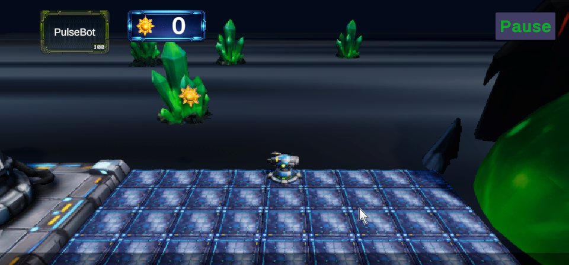
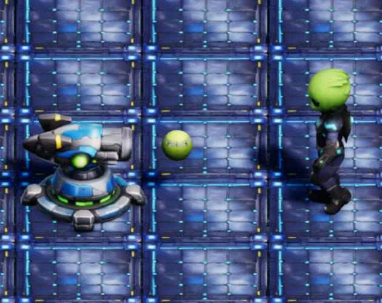

# Bots vs Aliens

**A 3D tower-defense game about a squad of modular bots holding the line against an alien swarm.**

Built in Unity 6 as a portfolio project to explore grid-based placement, wave spawning, enemy AI, and energy-driven combat.

[](https://adeelgamedev.itch.io/bots-vs-aliens)




## Play

**Play the free WebGL build:** [adeelgamedev.itch.io/bots-vs-aliens](https://adeelgamedev.itch.io/bots-vs-aliens)

No download required. A desktop browser is recommended.

## About

Bots vs Aliens is a fan-inspired 3D take on the lane-defense formula. Deploy bots on the grid, generate photon energy, and survive escalating alien waves. It started as a study of *Plants vs. Zombies*' core loop and grew into its own sci-fi setting with modular units, a photon economy, and a guided tutorial.

## Features

- Grid-based bot placement with click-to-place and drag-and-drop controls
- Photon energy economy: collect falling photons and spend them on defenses
- Five bot types with distinct roles
- Wave-based alien spawning with per-level ramps and a bounded adaptive difficulty director ([balance notes](docs/balance.md))
- Tutorial plus three playable levels
- Pause menu, music, sound effects, and a WebGL release
- Pooled, ducked, headroom-aware audio mix ([audio notes](docs/audio.md))

### Bots

| Bot | Cost | Role |
| --- | ---: | --- |
| PulseBot | 100 | Ranged attacker |
| SpikeMine | 25 | Cheap delayed area damage |
| CrushPod | 50 | Crushes a lane on impact |
| SolarCore | 50 | Generates photon energy |
| ShieldCore | 50 | High-health blocker |

## Controls

| Action | Input |
| --- | --- |
| Select a seed packet | Left-click / tap |
| Plant a bot | Click a highlighted tile, or drag the packet onto a tile |
| Collect photon energy | Click / tap a falling photon |
| Remove a bot | Select the shovel, then click the bot |
| Pause | Click the Pause button |

## Screenshots



## Running the project

**Requirements:** Unity **6000.0.71f1** (Unity 6) with the Universal Render Pipeline.

1. Clone the repository:

   ```bash
   git clone https://github.com/AdeelGameDev/Bots-vs-Aliens.git
   ```

2. In Unity Hub, add the project folder and open it with **6000.0.71f1**.
3. Open `Assets/Scenes/Game.unity`.
4. Press **Play**.

The first import can take a few minutes. The public release targets **WebGL**.

## Project structure

```text
Assets/
  Art/               Models, textures, materials, fonts, animations
  Audio/             Music and sound effects
  Prefabs/           Bots, aliens, projectiles, environment
  Scenes/            Game.unity (main scene)
  ScriptableObjects/ Seed, level, and wave data
  Scripts/
    Plants/          Bot behaviours and shared plant base
    UI/              HUD, seed slots, tutorial, pause menu
    Tools/           Input and placement helpers
    Editor/          Editor utilities
  ThirdParty/        TextMesh Pro, CodeMonkey Health System
  Plugins/           DOTween
docs/balance.md      Difficulty curve, tuning levers and playtest checklist
docs/audio.md        Mix architecture, per-sound levels and listening checklist
docs/screenshots/    README images
```

## Tech

- Unity 6 (6000.0.71f1) and the Universal Render Pipeline
- C#
- Unity Input System
- TextMesh Pro
- DOTween
- CodeMonkey Health System

## Status

The game is playable from the tutorial through the current levels, and the WebGL build is the primary release. This is a solo portfolio project, so there is no automated test suite. Bug reports and suggestions are welcome via [GitHub Issues](https://github.com/AdeelGameDev/Bots-vs-Aliens/issues).

## Credits and third-party assets

- **Design, code, and project setup:** Adeel Bashir
- **TextMesh Pro:** Unity Technologies
- **DOTween:** Daniele Giardini / Demigiant
- **Health System:** CodeMonkey

Some code, graphics, audio, and text were created with AI assistance. The full disclosure is on the [itch.io page](https://adeelgamedev.itch.io/bots-vs-aliens).

Bots vs Aliens is a fan-inspired project. It is not affiliated with, endorsed by, or sponsored by PopCap Games or Electronic Arts. *Plants vs. Zombies* and related marks belong to their respective owners.

## License

The source code in this repository is released under the [MIT License](LICENSE).

Third-party packages, fonts, sounds, and art retain their own licenses and are **not** relicensed by the MIT license. See the relevant folders for their terms.
